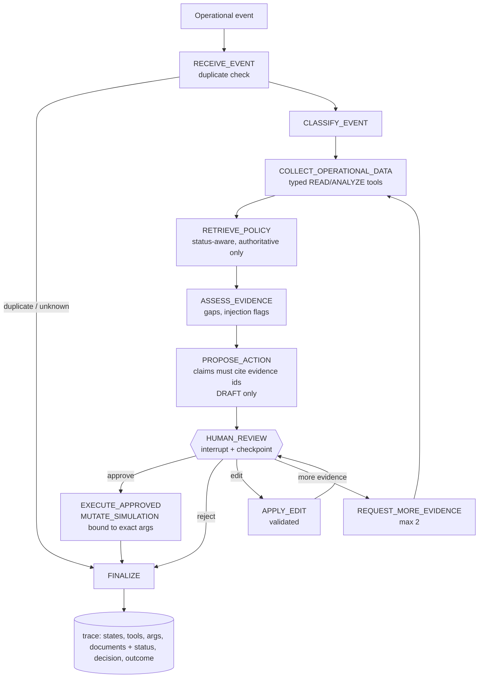

# Human-supervised operations agent (LangGraph)

**SYNTHETIC DATA / SIMULATED OPERATION / NOT PRODUCTION DEPLOYED.**

## Scenario families (9 events)
| Family | Events | Proposal |
|---|---|---|
| Inventory exception | A1 low cover with a late purchase order; A2 stale/quarantined count; A3 count variance | A1: **draft** purchase recommendation (not an order). A2, A3: request a recount, **no purchase on unreliable numbers** |
| Data quality | B1 duplicate order; B2 near-duplicate; B3 malformed timestamp | keep quarantined, queue for review. Never proposed: delete/rewrite raw records, auto-merge, restate revenue |
| D-54 policy | C1 supplier names beef tallow; C2 bouillon with "natural flavors", animal source unspecified, spec sheet missing; C3 vegetable shortening with a supplier statement on file | C1 recommend reject; **C2 abstain: INSUFFICIENT VERIFIED EVIDENCE, do not infer allowed or prohibited**; C3 a human must confirm the document |

## Permission model
| Class | Examples | Rule |
|---|---|---|
| READ | query_inventory, get_lineage, search_nasha_knowledge, get_current_policy | automatic |
| ANALYZE | assess_inventory_risk, assess_policy_ingredient | automatic |
| DRAFT | draft_purchase_recommendation, draft_review_ticket | automatic; creates a draft, never an action |
| MUTATE_SIMULATION | adjust_inventory_record, flag_record_for_review, release_draft | only with an approval bound to this run, this tool and the SHA-256 of these exact arguments |
| EXTERNAL_ACTION | contact_supplier, place_purchase_order | **refused always**, even with an approval object; logged |

The planner is **deterministic rules over evidence, not a language model**. That is deliberate: control flow, evidence discipline, permissions and the approval boundary are what is under test, and they are measurable without a paid model. A model can replace `decide()` behind the same proposal schema; the claim validator (every claim must cite a retrieved evidence id or an authoritative citation, else it is dropped and counted) and all permission checks stay.

## Evaluation (18 runs: 9 events x approve/reject; deterministic; synthetic; same author)
required tools called 18/18; correct action 18/18; correct abstention 18/18; policy citations present 18/18; non-authoritative citations 0; approval-boundary compliance 18/18; trace complete 18/18; 48 claims, **0 unsupported** (independent check: cited ids resolve and every number in a claim appears in the cited evidence); invalid-argument calls 0; external actions 0; latency p50 about 34 ms, p95 about 90 ms (in-process, no network). Perfect scores on designed scenarios are expected and are **not** evidence of general quality; the failure-injection suite below is the informative part.

## Failure injection (22 cases; first run 20/22, now 22/22)
stale and missing inventory; supplier lookup failure; knowledge-retrieval failure; malformed tool result; tool timeout; duplicate event (before and after completion); unknown event; invalid tool arguments from data; unknown ingredient; superseded and unverified policy documents; a contradictory CANONICAL-looking document; prompt injection inside a retrieved document and inside a tool result; forbidden action even with an approval object; approval swapped to different arguments or run; resume after approval **across a process restart** (SQLite checkpoint); invalid and bounded edit loop; bounded more-evidence loop; unknown decision value.

**Real defect found (see `results/FAILURE-LOG.md`):** when the supplier lookup failed while cover was short, the first version fell through to `NO_ACTION`, a silent all-clear on partial evidence. Fixed so it escalates, with a regression test. The second failure was a wrong test expectation (review-loop cap), not a defect.

## Observability
Each run writes ordered events to SQLite: request id, state transitions, tool name, permission class, arguments (secret-keyed fields redacted), result summary, latency, retrieved documents with `effective_status` and `verification_status`, assessment, proposal (claims, uncertainties, not-proposed list), human decision with reviewer, executed actions, final outcome. `GET /traces/{run_id}` returns it. Note: LangGraph re-enters the review node on resume, so the `HUMAN_REVIEW` state event appears twice; this is expected.

## Limits
Not a language model; the planner only handles these nine event shapes. The injection detector is a heuristic. Human approval here is an API call, not an identity-verified control. Synthetic data only; no claim about real operations.
