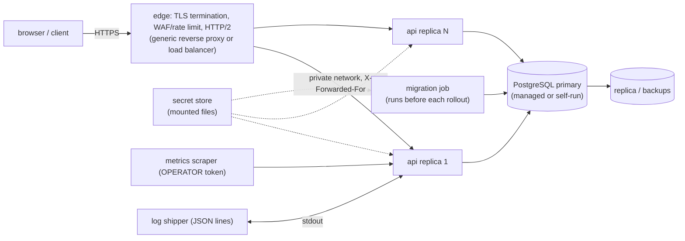

# P5 deployment architecture (a design, NOT a deployment)

**SYNTHETIC DATA / SIMULATED OPERATION / NOT PRODUCTION DEPLOYED.** Nothing described here exists. No server, cloud account, domain, DNS record, certificate, registry, secret manager or credential was created or used. This page says what a deployment of the hardened service would look like on generic infrastructure so the design can be reviewed.

## The stop line
Work stopped before: paid infrastructure, any public deployment, DNS, real credentials or production secrets. Crossing any of these needs an explicit owner decision, a budget, and a real secret-handling process. The test and CI secrets are generated per run and thrown away.

## Generic shape

## Mapping from this repository
| Concern | In the repo today | A deployment would add |
|---|---|---|
| TLS, WAF, IP trust | none; compose publishes on loopback only | an edge proxy; set `TRUSTED_PROXY_HOPS` to its hop count; keep `/readyz` and `/metrics` off the public listener |
| Secrets | files under `lab/secrets` (git-ignored) | a secret manager mounting files at `/run/secrets`, mode 0400, rotation per `P5-RUNBOOK.md` |
| Database | one pgvector container, one volume | managed PostgreSQL 16 or HA self-run, backups with a tested restore, separate migration and runtime roles (the runtime role without DDL rights) |
| Replicas | one api container | N replicas needs a shared agent checkpointer and a shared rate limiter (not built): until then run one replica per run state store, sticky routing |
| Rollout | `up` ordering via `depends_on` | migrate job, then rolling restart; expand/contract migrations so old and new builds overlap (`ALLOW_NEWER_SCHEMA` exists for exactly this) |
| Observability | `/metrics`, JSON logs, `traceparent` | a scraper, a log pipeline, alert rules on `nasha_db_up`, 5xx rate, `nasha_dead_letters{status="OPEN"}`; a trace collector if OpenTelemetry export is wanted |
| Images | pinned by tag, non-root, read-only | digest pinning, signing, SBOM, vulnerability scan, a private registry |
| Capacity | compose limits (1.5 CPU, 1.5 GiB api) | sized from load tests (none exist here) |

## Not covered
Cost, multi-region, disaster recovery objectives, compliance, on-call, real load tests. The SLO figures in `P5-HARDENED-SERVICE.md` section 12 are assumptions for such a design.
