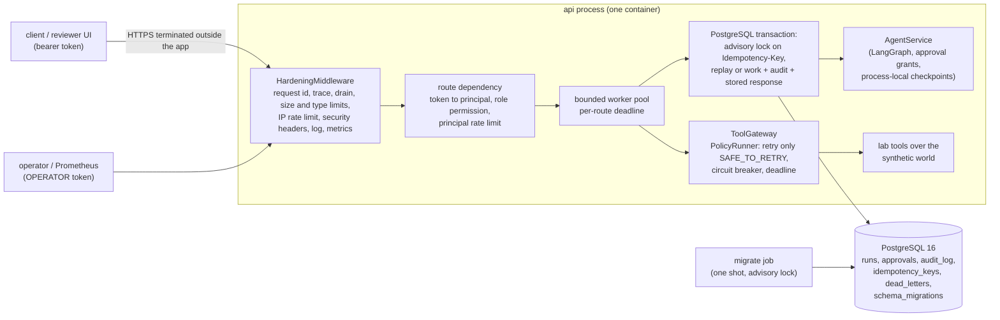
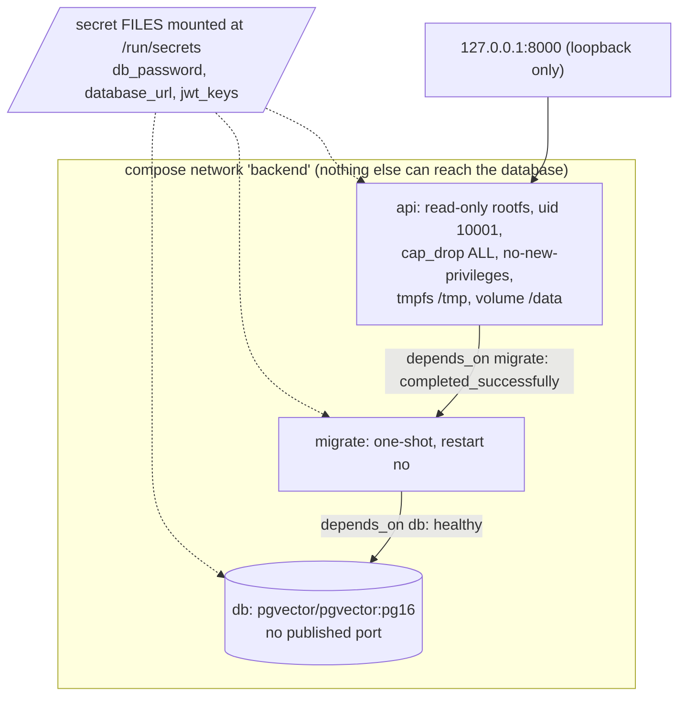

# P5: hardened service layer around the NASHA lab API

**SYNTHETIC DATA / SIMULATED OPERATION / NOT PRODUCTION DEPLOYED.** NASHA has no restaurant, customers, sales or staff. This is an engineering exercise on a synthetic lab: nothing here is a measured production result, nothing is deployed, and no real credential exists anywhere in this work.

**Docker status, stated plainly: Docker was NOT runnable in the authoring sandbox.** A Docker CLI and Compose v5.6.0 client are installed there but there is no daemon, so the Dockerfile and compose file were never built or started locally. The only local Docker check is the client-side `docker compose config -q`, which passed (and fails loudly when `POSTGRES_USER` is unset). They are checked statically (`tests/p5/test_p5_deploy_static.py` parses their text) and the only evidence that they build, start, become healthy and answer requests is the GitHub Actions workflow `.github/workflows/p5-service-ci.yml`; the result of that run is recorded in section 14.

## 1. What this is

P5 hardens one existing service, the lab API (`nasha_lab/api.py`, `serve.py`, `identity.py`, `agent.py`, the `ops/` package), without starting a new project. The existing `create_app` and all its tests are untouched. The new package `nasha_lab/service/` provides `create_hardened_app(settings)`, an additive second front door over the same agent, tools and failure policy:

| Module | Job |
|---|---|
| `config.py` | Pydantic v2 settings, validated at start, value-free errors, secrets as `SecretStr`, `_FILE` secrets |
| `auth.py` | signed bearer tokens (PyJWT, HS256, `kid`), roles, permissions |
| `ratelimit.py` | token buckets (per principal and per IP), bounded key table |
| `middleware.py` | request id, trace context, drain, size/type limits, IP limit, security headers, access log, metrics, last-resort error envelope |
| `app.py` | routes, dependencies, deadlines, idempotency transaction, readiness, metrics, shutdown |
| `db.py` / `store.py` | psycopg 3 pool with timeouts and a circuit breaker; SQL for runs, approvals, audit, idempotency, dead letters |
| `migrations.py` + `migrations/*.sql` | versioned, transactional, checksummed up/down migrations |
| `gateway.py` | read tools through `ops.failure_policy.PolicyRunner`; bridge from the JWT principal to the agent's approval grants |
| `obs.py` | JSON logs with redaction, Prometheus text, W3C trace context, bounded span ring |
| `errors.py` / `schemas.py` | the one error envelope, the stable error-code table, request/response models |

## 2. Requirement map (what was done, where it is tested, what was not done)

| Requirement | Implementation | Evidence | Status / limit |
|---|---|---|---|
| Typed Python | annotations on the whole package; `mypy.ini` with `disallow_untyped_defs`; `ruff.toml` | `mypy` reports no issues in the package; CI job `static` | mypy, not pyright. The older lab code is followed silently, not checked |
| Pydantic v2 settings, fail fast | `config.py` | `test_p5_unit.py` (config), `F14` | one reader of the environment (`load_settings`); unknown `NASHA_SVC_*` names are errors |
| Secret handling | `SecretStr`, `*_FILE`, log scrubber, placeholder-only test secrets generated at test time, secret scan in CI | `test_p5_unit.py`, `test_p5_security.py::test_no_secret_or_token_appears_in_logs_responses_or_errors` | no secret manager integration (stop line: no real credentials) |
| PostgreSQL via psycopg v3 + pool | `db.py`, `store.py` | all `p5_pg` tests on a real server | psycopg_pool, sync driver in a bounded thread pool |
| Run state, approvals, idempotency keys, audit log, dead letters | migrations 0001 to 0003 | `test_p5_service.py`, `F07`, `F12*` | audit log append-only by trigger (a superuser can drop it) |
| Migrations versioned, transactional, checksummed, up/down, rollback procedure | `migrations.py`, `P5-RUNBOOK.md` section 5 | `test_p5_migrations.py` (13 tests), `F11*`, `F13` | down scripts are data-destructive by nature; see the runbook |
| Real PostgreSQL in tests, clean skip | `pgserver` fixture or `NASHA_PG_DSN` | `tests/p5/conftest.py` | skip is by design; CI forbids skips |
| Authentication | JWT HS256 with `kid`, exp/iat/iss/aud/jti required, algorithm pinned, lifetime capped | `test_p5_unit.py` (18 token cases), `F04`, `F05` | HS256 (symmetric): issuer and verifier share a secret. Ed25519/RS256 is the next step if a separate issuer is introduced; not done, not needed while the issuer is the CLI/dev tool |
| Authorization | role to permission table, one permission per route, deny by default enforced at start-up | `test_role_permission_matrix_is_enforced_on_every_route`, `test_startup_refuses_a_route...` | five-plus roles; no groups, no per-object ACL beyond run ownership |
| Rate limiting | token buckets per principal and per IP, 429 + `Retry-After` | `F06`, properties test | in memory, per process (see 9) |
| Timeouts, deadlines, cancellation | per-route deadlines, DB statement/lock/pool timeouts, cancel-before-commit | `F03`, `F03b`, `F16`, `F16b` | threads cannot be killed: see 9 |
| Failure classification | `errors.py` maps every code to a `failure_policy` failure class and client retry advice | `test_error_table_maps_to_failure_policy_classes...` | reuses `ops.failure_policy` |
| Retry policy | only `PolicyRunner` retries, only for operations the policy classes `SAFE_TO_RETRY`; mutating work is never retried by the server | `F08`, `F09`, `F12b` | no blanket retries |
| Idempotency | `Idempotency-Key`, advisory-lock serialisation, stored response, hash mismatch 422 | `test_p5_service.py`, `F07`, `F16` | keys expire after 24 h; only successful responses are stored |
| One error envelope, stable codes | `errors.py`, snapshot `tests/p5/snapshots/error_codes.json` | `test_p5_contract.py` | |
| Structured JSON logs | `obs.py` | `test_p5_unit.py`, security tests | principal id appears only as a keyed hash |
| Prometheus metrics | `/metrics` (OPERATOR token) | `test_metrics_endpoint_requires_operator...`, `F19` | scraping needs a bearer token |
| Traces | W3C `traceparent` in and out; spans in a bounded ring and in logs | `test_traceparent_parsing_and_span_nesting...`, `test_request_and_trace_ids_are_propagated` | **no OpenTelemetry SDK**: there is no collector in this repository, so there would be no export path; adding it would be for keywords |
| Health, readiness, graceful shutdown | `/healthz`, `/readyz`, drain + wait + close | `test_readyz_reports_each_dependency`, `test_graceful_shutdown_...`, `F18` (real uvicorn socket) | |
| Docker hardening, compose, env example | `Dockerfile.service`, `Dockerfile.service.dockerignore`, `docker-compose.service.yml`, `.env.example`, `secrets/` | static tests; **CI only** for build/run | digest pinning, image signing, SBOM, vulnerability scan not done |
| CI | `.github/workflows/p5-service-ci.yml` | section 14 | |

## 3. Architecture

This second diagram is the compose file as written. It is a design that CI exercises; it is not a deployment (see `P5-DEPLOYMENT-ARCHITECTURE.md`).

### Request data flow (start of a run)

1. Middleware assigns/validates `X-Request-ID`, continues or starts a `traceparent`, refuses new work when draining, rejects bodies over `max_body_bytes` (by `Content-Length` and while streaming) and non-JSON media types, and takes a token from the per-IP bucket.
2. The route dependency parses the bearer header, verifies the JWT (`kid`, algorithm, signature, issuer, audience, expiry), checks the role's permission, and takes a token from the per-principal bucket.
3. The handler runs in the bounded pool under the route deadline. One PostgreSQL transaction takes `pg_advisory_xact_lock(principal|key)`; a stored response for the key is replayed, a different request hash under the same key is a 422, otherwise the work runs: event lock, existence checks, agent start (or adoption of a run the agent already holds), `runs` insert, audit insert, and the idempotency row, then commit.
4. The deadline is checked immediately before commit; a request that already answered 504 rolls back.

### Trust boundaries

| Boundary | Crossing | Control |
|---|---|---|
| Internet to reverse proxy | not in this repo | TLS termination, outside the app (deployment doc) |
| Proxy to API | HTTP | bearer token on every route except `/healthz`, `/readyz`; forwarded headers ignored unless `trusted_proxy_hops` is set |
| API to PostgreSQL | TCP, internal network | credentials from a mounted file; bound parameters only; statement/lock/idle timeouts |
| API to agent and tools | in process | tools remain behind the lab's own permission, approval-grant and taint checks; the JWT role does not widen the lab's `ROLE_POLICY` |
| Operator to `/metrics`, `/v1/audit`, dead letters | HTTP | OPERATOR (or AUDITOR for audit) role only |
| Secret files to process | file mount | read once at start-up into `SecretStr`; never logged |

## 4. Configuration

All settings are environment variables with the prefix `NASHA_SVC_`; secrets may instead be given as `NASHA_SVC_<NAME>_FILE`. Generated from `Settings.model_fields`:

| Variable | Type | Default | Note |
|---|---|---|---|
| `NASHA_SVC_ENV` | dev, test, staging | dev | `staging` forbids the dev token issuer and API docs |
| `NASHA_SVC_DATABASE_URL` | secret | required | `postgresql://` URL or libpq conninfo; env or `_FILE` |
| `NASHA_SVC_DB_POOL_MIN` / `_MAX` | int | 1 / 10 | |
| `NASHA_SVC_DB_POOL_TIMEOUT_S` | float | 2.0 | max wait for a pooled connection |
| `NASHA_SVC_DB_CONNECT_TIMEOUT_S` | int | 3 | |
| `NASHA_SVC_DB_STATEMENT_TIMEOUT_MS` | int | 3000 | server-side cancel |
| `NASHA_SVC_DB_LOCK_TIMEOUT_MS` | int | 2000 | bounds idempotency/row lock waits |
| `NASHA_SVC_DB_BREAKER_THRESHOLD` / `_RESET_S` | int / float | 3 / 5.0 | database circuit breaker |
| `NASHA_SVC_REQUIRE_DB_AT_START` | bool | false | true: refuse to start without a database; false: start degraded, `/readyz` 503 |
| `NASHA_SVC_ALLOW_NEWER_SCHEMA` | bool | false | true: a database migrated beyond this build is still ready (additive-migration rollback) |
| `NASHA_SVC_JWT_KEYS` | secret JSON `{kid: key}` | required | each key at least 32 characters and not placeholder-like; env or `_FILE` |
| `NASHA_SVC_JWT_ACTIVE_KID` | str | required | must be in `JWT_KEYS` |
| `NASHA_SVC_JWT_ISSUER` / `_AUDIENCE` | str | nasha-lab-dev / nasha-lab-api | |
| `NASHA_SVC_JWT_LEEWAY_S` | int | 5 | clock skew allowance |
| `NASHA_SVC_TOKEN_MAX_TTL_S` | int | 3600 | longer-lived tokens are rejected |
| `NASHA_SVC_DEV_TOKEN_ISSUER` | bool | false | only with env dev/test; adds `POST /v1/dev/token` |
| `NASHA_SVC_RATE_IP_CAPACITY` / `_REFILL_PER_S` | float | 60 / 30 | per client address |
| `NASHA_SVC_RATE_PRINCIPAL_CAPACITY` / `_REFILL_PER_S` | float | 30 / 10 | per token subject |
| `NASHA_SVC_RATE_TABLE_MAX` | int | 10000 | bound on tracked keys |
| `NASHA_SVC_TRUSTED_PROXY_HOPS` | int | 0 | how many `X-Forwarded-For` hops to trust |
| `NASHA_SVC_MAX_BODY_BYTES` | int | 16384 | |
| `NASHA_SVC_DEFAULT_DEADLINE_S` / `_RUN_DEADLINE_S` / `_TOOL_TIMEOUT_S` | float | 5 / 15 / 2 | tool timeout must be below the run deadline |
| `NASHA_SVC_WORKER_THREADS` | int | 16 | bounded pool for blocking work |
| `NASHA_SVC_SHUTDOWN_GRACE_S` | float | 10 | drain wait on shutdown |
| `NASHA_SVC_IDEMPOTENCY_TTL_S` | int | 86400 | |
| `NASHA_SVC_CORS_ORIGINS` | JSON list | [] | explicit origins only; `*` is a config error |
| `NASHA_SVC_DOCS_ENABLED` / `_METRICS_ENABLED` | bool | false / true | |
| `NASHA_SVC_LOG_LEVEL` | DEBUG..ERROR | INFO | |
| `NASHA_SVC_LOG_SALT` | secret, optional | random per process | keys the principal hash in logs |
| `NASHA_SVC_DATA_DIR` | path | /tmp/nasha_lab | agent trace/checkpoint files, dead-letter spool |
| `NASHA_SVC_WORLD_SEED` | int | 1 | synthetic world seed |

`python -m nasha_lab.service check-config` prints the validated configuration with secrets masked. An invalid configuration stops the process with exit code 78 and a message that names settings and reasons and never values.

## 5. Authentication, roles and routes

Token claims: `iss`, `aud`, `sub` (`[A-Za-z0-9_.:@-]{1,64}`), `role`, `iat`, `exp`, `jti`; header `kid`. A token cannot carry permissions: only the role maps to them.

| Role | Permissions |
|---|---|
| BUYER, QUALITY_LEAD | tools:read, runs:create, runs:read_own, runs:read_all, runs:decide |
| FOUNDER | same as BUYER |
| READER | tools:read, runs:read_own |
| OPERATOR | tools:read, runs:read_own, runs:read_all, metrics:read, deadletters:read, deadletters:resolve, audit:read |
| AUDITOR | runs:read_own, runs:read_all, audit:read |

`runs:decide` is held only by the three reviewer roles, and the lab's own `identity.ROLE_POLICY` still decides which reviewer role may approve which mutation (a QUALITY_LEAD approving a supplier-proposal flag is refused with `ROLE_NOT_PERMITTED`). OPERATOR and AUDITOR cannot approve anything.

| Route | Permission | Idempotency-Key |
|---|---|---|
| `GET /healthz`, `GET /readyz` | public | no |
| `GET /metrics` | metrics:read | no |
| `GET /v1/events`, `GET /v1/inventory/{ingredient}`, `GET /v1/quality/findings`, `POST /v1/knowledge/ask` | tools:read | no (read-only) |
| `POST /v1/runs` | runs:create | required |
| `GET /v1/runs`, `GET /v1/runs/{run_id}` | runs:read_own (all runs with runs:read_all; others get 404, the same answer as for a missing run) | no |
| `POST /v1/runs/{run_id}/approve`, `.../reject` | runs:decide | required |
| `GET /v1/dead-letters` | deadletters:read | no |
| `POST /v1/dead-letters/{dl_id}/resolve` | deadletters:resolve | required |
| `GET /v1/audit` | audit:read | no |
| `POST /v1/dev/token` | public, exists only with `DEV_TOKEN_ISSUER` in dev/test | no |

## 6. Errors

One envelope: `{"error": {"code", "message", "request_id", "failure_class", "client_retry", "retry_after_s"?, "details"?}}`. `failure_class` is one of `ops.failure_policy.FAILURE_CLASSES`; `client_retry` tells a client what is safe: `never`, `after_retry_after`, `same_idempotency_key`, `reconcile_first`, `after_human_review`. The ambiguous codes (`DEADLINE_EXCEEDED`, `DB_TIMEOUT`, `DECISION_AMBIGUOUS`) are never advised as blind retries. The table is pinned by `tests/p5/snapshots/error_codes.json`:

| Code | HTTP | Failure class | Client retry |
|---|---|---|---|
| AUTH_REQUIRED | 401 | AUTH | never |
| AUTH_INVALID_TOKEN | 401 | AUTH | never |
| AUTH_TOKEN_EXPIRED | 401 | AUTH | never |
| FORBIDDEN | 403 | AUTH | never |
| ROLE_NOT_PERMITTED | 403 | AUTH | never |
| NOT_FOUND | 404 | PERMANENT | never |
| ROUTE_NOT_FOUND | 404 | PERMANENT | never |
| UNKNOWN_EVENT | 404 | PERMANENT | never |
| METHOD_NOT_ALLOWED | 405 | VALIDATION | never |
| MALFORMED_BODY | 400 | VALIDATION | never |
| IDEMPOTENCY_KEY_REQUIRED / IDEMPOTENCY_KEY_INVALID | 400 | VALIDATION | never |
| UNSUPPORTED_MEDIA_TYPE | 415 | VALIDATION | never |
| PAYLOAD_TOO_LARGE | 413 | VALIDATION | never |
| INVALID_REQUEST | 422 | VALIDATION | never |
| IDEMPOTENCY_KEY_REUSED | 422 | VALIDATION | never |
| IDEMPOTENCY_BUSY | 409 | TRANSIENT | same_idempotency_key |
| CONFLICT_STATE, EVENT_ALREADY_PROCESSED | 409 | VALIDATION | never |
| RUN_NOT_RESUMABLE | 409 | PERMANENT | never |
| RATE_LIMITED | 429 | RATE_LIMIT | after_retry_after |
| DEADLINE_EXCEEDED | 504 | TIMEOUT_AMBIGUOUS | same_idempotency_key |
| DB_TIMEOUT | 504 | TIMEOUT_AMBIGUOUS | same_idempotency_key |
| TOOL_TIMEOUT | 504 | TIMEOUT_AMBIGUOUS | after_retry_after |
| UPSTREAM_FAILURE | 502 | TRANSIENT | after_retry_after |
| UPSTREAM_MALFORMED | 502 | MALFORMED_RESULT | never |
| DEPENDENCY_UNAVAILABLE, DB_UNAVAILABLE, DB_POOL_EXHAUSTED, NOT_READY, SHUTTING_DOWN | 503 | DEPENDENCY_DOWN | after_retry_after |
| SCHEMA_MISMATCH | 503 | DEPENDENCY_DOWN | never |
| DECISION_AMBIGUOUS | 500 | TIMEOUT_AMBIGUOUS | after_human_review |
| INTERNAL_ERROR | 500 | PERMANENT | never |

## 7. Persistence and migrations

Tables (migration 0001): `runs` (state, owner, summary jsonb, partial unique index: one live run per event), `approvals`, `audit_log` (append-only trigger, migration 0002), `idempotency_keys` (primary key principal+key, request hash, stored response, expiry), `dead_letters` (the `failure_policy.OpsStore` columns and replay instructions, plus `resolved_by`). Migration 0003 adds query indexes. `schema_migrations(version, name, checksum, applied_at)` records what ran.

The migrator takes a session advisory lock (concurrent migrators serialise), runs each migration and its bookkeeping row in one transaction (a failed statement rolls back the whole migration and leaves the version unchanged), verifies applied checksums before doing anything (an edited migration is `CHECKSUM_MISMATCH` and blocks `up` and `down`), refuses to run when the database holds versions the build does not know (`SCHEMA_NEWER`) or has a gap, and applies `down` scripts newest first, each in its own transaction. Rollback procedure: `P5-RUNBOOK.md` section 5.

## 8. Idempotency, ambiguity, retries

* Mutating routes require `Idempotency-Key` (8 to 128 characters of `[A-Za-z0-9_.:-]`). Keys are per principal. The request hash covers method, route, path parameters and canonical body.
* Same key and same request: the stored response is returned with `Idempotent-Replay: true`, the work does not run again. Same key and a different request: 422 `IDEMPOTENCY_KEY_REUSED`. Concurrent duplicates block on the advisory lock and then replay (20 concurrent identical requests produced one run, 19 replays: scenario F07).
* Only successful (2xx) responses and the deterministic reconciliation 409 are stored; transient failures are not cached, so a retry actually retries.
* Operation classes used (from `ops/failure-policy.json`, not redefined here): run start is `SAFE_WITH_IDEMPOTENCY_KEY` (key plus event id); the approval-execute step is `HUMAN_REVIEW_REQUIRED` (never retried by the server; an ambiguous outcome goes to the dead-letter queue); read tools are `SAFE_TO_RETRY` (up to three attempts with backoff, a retry budget and a per-tool circuit breaker, all inside the request deadline).
* Run start crash window: the agent run is in-process state, the row is in PostgreSQL, so they cannot share a transaction. If the process or the database fails between them, the retry with the same key finds the agent's existing run for that event and adopts it (`reconciled: true`) instead of starting a second one (F02, F12a, F16).
* Approval crash window: if the approval executed in the agent but the database could not record it, the response is 500 `DECISION_AMBIGUOUS`, the transaction rolled back, and a dead letter is written (to a local JSONL spool if the database itself is down; it is replayed idempotently when `/readyz` next sees a healthy database). Retrying with the same key returns a 409 that says the run was already decided, reconciles the row to the agent's state and executes nothing again (F12b, F12c).

## 9. Rate limits, deadlines, cancellation: limits of the design

* Token buckets are in process memory. N replicas allow N times the configured rate; a restart resets buckets; the table is bounded (LRU), so a flood of distinct keys can evict a victim's bucket. A shared limiter (Postgres or Redis) is not built.
* `X-Forwarded-For` is ignored unless `TRUSTED_PROXY_HOPS` is set (tested), so a client cannot dodge the IP limit by a header.
* A Python thread cannot be killed. A request that hits its deadline answers 504 immediately and the worker is told to stop; it checks the deadline right before commit and rolls back, but a long step that does not check (an agent step) runs to completion, and its side effect in the agent (not in PostgreSQL) can remain. That is why start/approve are idempotent and reconciling rather than "cancelled" (F16, F16b). Work still queued at its deadline is cancelled before it starts.
* The worker pool is bounded (`WORKER_THREADS`); when saturated, waiting counts against the deadline.

## 10. Observability

* Logs: one JSON object per line, whitelisted fields only (`request_id`, `trace_id`, `span_id`, `route` as the template, `status`, `ms`, `principal` as a keyed 12-hex hash, `ip_hash`, `code`); free text is scrubbed of bearer tokens, JWT-shaped strings, URL passwords and `password=` style assignments; exceptions log the type and (for unhandled ones) the source location, never the message.
* Metrics (`/metrics`, Prometheus text 0.0.4): `nasha_http_requests_total{method,route,status}`, `nasha_http_request_duration_seconds` (histogram), `nasha_http_errors_total{status}`, `nasha_errors_total{code}`, `nasha_auth_failures_total{reason}`, `nasha_rate_limited_total{scope}`, `nasha_idempotent_replays_total`, `nasha_deadline_exceeded_total`, `nasha_db_pool{state}`, `nasha_db_up`, `nasha_db_errors_total{kind}`, `nasha_schema_version`, `nasha_dead_letters{status}`, `nasha_dead_letters_created_total`, `nasha_dead_letter_spooled_total`, `nasha_tool_calls_total`, `nasha_tool_retries_total`, `nasha_inflight_requests`, `nasha_rate_limiter_keys{scope}`, `nasha_build_info`. Memory is bounded by label cardinality (routes are templates, not raw paths).
* Traces: `traceparent` is continued or started, echoed in the response, and carried by `contextvars` into worker threads; spans (`db.tx`, `agent.start`, `agent.resume`, `tool.*`) are kept in a bounded ring (`ops.telemetry.JsonLogger` made bounded) and logged at DEBUG. The stock `ops.telemetry.MetricsRegistry` and `JsonLogger` grow without limit, which is acceptable for an offline evaluation and not for a service, so the service uses bounded equivalents.

## 11. Health, readiness, shutdown

`/healthz` has no dependencies. `/readyz` checks the database (one transaction), the schema version against the build (`SCHEMA_OLDER`, `SCHEMA_NEWER`), the agent's world and knowledge base, and the drain flag; any failure is a 503 with `details.failed` and per-check detail, cached for one second so probes cannot become a database load. On shutdown the service sets the drain flag (new work gets 503 `SHUTTING_DOWN`, `/readyz` goes 503, `/healthz` stays 200), waits up to `SHUTDOWN_GRACE_S` for in-flight requests, then closes the pool. Verified on a real uvicorn socket (F18).

## 12. SLO design targets (ASSUMPTIONS, not measurements)

There is no production traffic, so these are targets a deployment would be designed against, not results:

| Objective | Design target (assumed) | How it would be measured |
|---|---|---|
| Availability of `/v1` reads | 99.5% of requests non-5xx over 30 days | `nasha_http_requests_total` |
| Read latency | p95 under 500 ms for `/v1` read routes | `nasha_http_request_duration_seconds` |
| Run start latency | p95 under 2 s | same, route `/v1/runs` |
| Readiness after a database blip | recovers without restart within the pool's reconnect backoff | F01 shows recovery in the test; the figure is wall-clock on one machine |
| Dead letters | open dead letters triaged within one business day | `nasha_dead_letters{status="OPEN"}` |
| Zero duplicate side effects | 0 duplicate runs/approvals from retried requests | counts in F07, F12 |

## 13. Failures found while building this (summary; full table in `P5-FAILURE-LOG.md`)

Found by the failure and security tests and fixed with regression tests: a service that started while the database was down never recovered (`ConnectionPool.wait()` closes the pool on timeout); an incompatible schema produced a 500; a NUL byte in a decision note was accepted and then failed after the agent had already executed the approval; secrets read from a mounted file were mis-parsed; a few status mappings were wrong. Two behaviours were found and are residual, not fixed: see section 15.

## 14. Evidence

**Local (this sandbox, Python 3.13, real PostgreSQL 16.2 through `pgserver`):** the whole lab suite `cd lab && python3 -m pytest -q -p no:cacheprovider tests` gave **555 passed, 3 skipped** (the skips are older optional integrations). `tests/p5/` has 181 tests; ruff and mypy are clean on `nasha_lab/service` and `tests/p5`.

| Kind | File | Tests |
|---|---|---|
| unit (config, secrets, tokens, limiter, observability, error table) | `test_p5_unit.py` | 54 |
| property-based (hypothesis) | `test_p5_properties.py` | 5 |
| migration (real PostgreSQL) | `test_p5_migrations.py` | 13 |
| integration (real PostgreSQL) | `test_p5_service.py` | 31 |
| security | `test_p5_security.py` | 32 |
| contract (normalised OpenAPI snapshot, response models, error table) | `test_p5_contract.py` | 9 |
| failure injection (28 recorded scenarios in `results/p5/failure_scenarios.json`, all passing; some tests record two) | `test_p5_failures.py` | 27 |
| deployment files, static | `test_p5_deploy_static.py` | 10 (one needs hadolint and skips locally; `docker compose config -q` runs and passes locally) |

**CI (GitHub Actions), the only evidence for anything involving a Docker daemon.** First runs, head `f32e62b`:

| Run | Job | Conclusion |
|---|---|---|
| p5-service-ci 38970640269 | lint, types, Dockerfile lint (hadolint), secret scan | success |
| | unit, integration (PostgreSQL), contract, security, migration up/down (pgvector service container, no skips allowed) | success |
| | docker build, compose config, up, health, contract smoke | failure, only at the final graceful-stop step; the image built, `compose config -q` passed, migrate job applied 1..3, api became ready, every contract smoke call and the hardening checks passed, and the shutdown log lines were present; the container exited 143 (SIGTERM re-raised by uvicorn) where the step expected 0 (finding P5-C3) |
| lab-ci 38970640194 | test (full suite, requirements-dev) | failure: 2 tests failed, 554 passed, 2 skipped (P5-C1 OpenAPI snapshot sensitive to the pydantic version; P5-C2 a test that confused the CI password `nasha` with the logger name) |
| | docker (the legacy image) | success |
| lab-ci 38967684841 (head `13adf4a`, earlier) | test | failure: `ModuleNotFoundError: pydantic_settings` (requirements-dev not yet updated in that commit; fixed in `f32e62b`) |

All three causes are in `P5-FAILURE-LOG.md` section A2 and were fixed in the next commit; the result of the run on that commit is recorded here: on commit 24736e8, p5-service-ci run 39007698821 concluded **success** in all three jobs (lint/types/hadolint/secret scan; unit, integration on PostgreSQL, contract, security, migration up/down with no skips; docker build, compose up, readiness, contract smoke, hardening facts and graceful stop) and lab-ci run 39007698625 concluded **success** (test and docker jobs). The Docker evidence is therefore CI-only; local Docker was NOT verified (no daemon in the authoring sandbox).

Docker evidence, plainly: locally only the client-side `docker compose config -q` was run. Everything else (image build, hadolint, compose up, healthchecks, non-root and read-only-rootfs facts, the container smoke test, graceful stop) rests on the CI jobs above.

## 15. Known limitations and residual risks

* Single-process agent state: the agent's LangGraph checkpoints and trace store are process-local SQLite files in `DATA_DIR`. Run state in PostgreSQL survives a restart, but resuming a run needs the same `DATA_DIR`; scaling the API horizontally needs a shared checkpointer (not built). `RUN_NOT_RESUMABLE` is the honest answer when the agent has lost a run.
* A run started by an agent step that outlives its deadline can leave an agent-side effect without a database row until the idempotent retry reconciles it (F16).
* HS256 shared-secret tokens; no revocation list (a token is valid until `exp`, at most `TOKEN_MAX_TTL_S`; rotate the key to invalidate all).
* In-memory rate limits (section 9). No per-object ACL beyond run ownership.
* The audit log is append-only by trigger, not tamper-proof against a database superuser.
* No dependency lock file or image digest pinning; no SBOM or vulnerability scan.
* Pool reconnect behaviour was verified with an injected proxy and a local server, not under real network partitions.
* The Docker/compose evidence is CI-only (top of this document).
