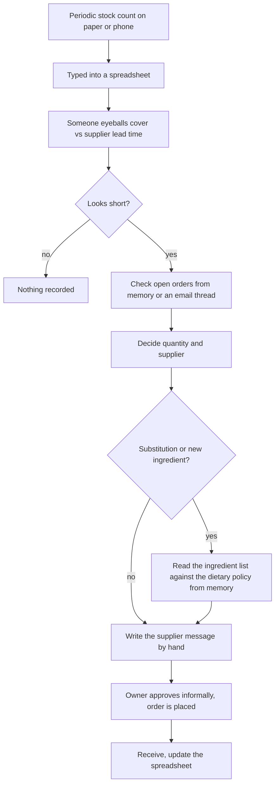

# 01. Problem, workflow choice, stakeholders and current state

**SYNTHETIC / SIMULATED.** NASHA is an independent founder concept: no restaurant, brewery, customer, supplier, employee or sale exists, and nothing here was discovered by talking to anyone. Personas are labelled SIMULATED and are never evidence of need or demand. Assumption ids (A-nn) point to `08-assumptions-register.md`.

## 1. The question

> If NASHA (or any small food-and-beer operation with the same constraints) runs an inventory-exception workflow, **which parts of it, if any, should use AI**?

The strongest permitted answer is "none of it". This case tests that answer fairly instead of assuming it.

## 2. Problem statement

A multi-ingredient kitchen and bar can run short of an ingredient because stock is lower than its supplier lead time covers, because the count is stale or wrong, because an open order is too small or too late, or because the only supplier is unavailable. Separately, a supplier substitution can quietly violate the founder's binding dietary policy D-54 (beef-free and pork-free, derivatives included, and explicitly not a halal claim). The cost of the two failure types differs in kind: a missed shortage costs stock-out, waste or rushed buying; a missed D-54 violation is a policy breach the founder has declared binding.

The workflow turns signals (counts, movements, open orders, supplier status, substitution proposals) into one of: no action, request a recount, draft a purchase recommendation, escalate because no supplier is active, or escalate because the evidence is insufficient. A human approves every consequential step (A-03).

Why this is a product question and not only an engineering one: the workflow is small and rule-shaped, which makes AI look unnecessary, but it also contains a language-shaped edge (supplier messages, explanations) where AI is the obvious temptation. The product decision is where to draw the line, and what evidence would move it.

## 3. Choice of workflow, and two alternatives considered

| Criterion | **A. Inventory-exception triage and reorder / escalation (chosen)** | B. D-54 supplier-substitution review (alone) | C. Data-quality incident triage (duplicates, malformed records) |
|---|---|---|---|
| Contains arithmetic, policy, supplier choice, language and approval in one flow | Yes, all five | Policy and approval only | Detection and review only |
| Consequence of a silent failure | Stock-out, waste, or an unreliable count driving a wrong order | Policy breach, but the system never auto-approves, so the failure needs a reviewer to also miss it | Wrong analytics; no immediate physical consequence |
| Existing evidence about the AI question | The most: all 30 of the raw 1.5B model's silent all-clears fall here (my re-analysis, `05`), the PO coverage rule gap was found here, the 7B model passed only here | Planner results exist (policy family n=42 on the 1.5B run) but the family is one rule table | Planner results exist; detection itself is rules with injected-defect recall (`results/eval_v1.json`) |
| Ground truth can be verified later against a physical outcome (stock-out or not) | Yes, in a real pilot | Partly: policy truth is a document, not an outcome | No physical outcome |
| Room for a legitimate AI role | Drafting, explaining, an add-only second opinion | A second-opinion flagger for derivative names outside the lexicon (see `05` section 7) | Weak: the rules already reach recall 1.0 on the 11 injected types they cover |
| Verdict | Chosen: widest decomposition and the strongest test of "AI at all" | Kept as a **sub-task** of A (it is where the non-AI baseline has its most instructive weakness) | Rejected: too rule-dominated to carry a product argument; its AI question is the same as A's detection sub-task |

Not chosen on purpose: a weekly management narrative or dashboard commentary. It is the most LLM-friendly workflow, which is exactly why it would make a flattering but low-stakes case.

## 4. Decomposition into sub-tasks

| # | Sub-task | Input | Output | Who does it today in the lab |
|---|---|---|---|---|
| T1 | Detection | counts, movements, open orders, supplier master | an exception class (or none) | `assess_inventory_risk`, `query_inventory` (rules) |
| T2 | Coverage arithmetic | on-hand estimate, 14-day average usage, lead time, open orders | days of cover, quantity needed through lead time, whether an open order covers it | same tools; quantity-aware rule v2 |
| T3 | D-54 dietary check | substitution proposal text, declared source, spec-sheet status | PROHIBITED, REQUIRES_REVIEW, CLEARED_PENDING_HUMAN or NO_POLICY_SIGNAL | `assess_policy_ingredient` (lexicon plus hidden-derivative checklist) |
| T4 | Supplier selection | candidate suppliers, status, lead time, minimum order | one active supplier or none | a single query, one supplier per ingredient in the synthetic data |
| T5 | Drafting the supplier message | verified facts from T1 to T4 | text a human can send | **not built**: the lab drafts a structured recommendation only and never contacts a supplier |
| T6 | Explaining to a human | the evidence | headline, cited claims, uncertainties, "not proposed" list | deterministic templates with evidence ids |
| T7 | Approval | the proposal | approve, edit, reject, ask for more evidence | human, with a signed grant bound to the exact arguments |

## 5. Stakeholders (all SIMULATED)

None of these people exists; the descriptions are design hypotheses used to structure questions for real discovery (P8). **They are not evidence of demand.**

| Persona (SIMULATED) | Job in the workflow | What the design assumes they care about | What real discovery must ask (no answers are invented here) |
|---|---|---|---|
| Operations manager | Owns stock levels and supplier relationships; reviews proposals | Not running out; not being buried in alerts | How do you learn today that something will run short? How many alerts per day would you stop reading? |
| Kitchen lead | Counts, recounts, flags quality | Counts that are fast to take; not being asked to recount for nothing | How often are counts wrong or late? What does a recount cost in minutes? |
| Founder-approver | Owns D-54 and spending authority (D-81) | Nothing is bought or promised without authority; the dietary policy is not breached; no halal claim | Which decisions would you refuse to delegate to software at all? |
| Supplier contact (external) | Receives messages | Clear, correct quantities and dates | What makes a purchasing message easy or hard to act on? |
| Ops data owner | Maintains rules and the D-54 lexicon | Changes are tested and reversible | Who updates the lexicon and how fast? |

## 6. Current-state workflow (ASSUMED reference process, not observed)

No NASHA operation exists, so the current state is the typical manual or spreadsheet process for a small multi-ingredient operation. It is the starting point to validate in discovery, not a finding.

### Pain points (hypotheses, with the one kind of evidence the lab does provide)

| ID | Hypothesised pain point | Evidence in the lab | What it does and does not show |
|---|---|---|---|
| PP-1 | Stale or wrong counts drive wrong orders | Synthetic families `stale_count`, `missing_count`, `count_variance`, `quarantined_newer_count` exist; the deterministic planner asks for a recount instead of a purchase | Shows the logic is expressible; says nothing about how often it happens |
| PP-2 | "There is an open order" is treated as cover regardless of size | Real finding: a 1 kg order "covered" a 30 kg shortfall; rule-gap probes 0 of 8, fixed to 8 of 8 (`results/ext1_planner_deterministic.json`, `..._poq2.json`) | Shows this logic is easy to get wrong, including by the author. Not evidence that real operators make this error |
| PP-3 | Dietary policy checked from memory | The policy has hidden derivatives (stocks, broths, gelatin, shortening, rennet); the author's own oracle misclassified several in the first ext1 run (92 of 103 before correction, `docs/EVAL-HARDENING.md`) | Shows the policy is subtle even for its author |
| PP-4 | No audit trail of why an order was or was not placed | Lab traces every tool call and decision | A property of the design, not a measured pain |
| PP-5 | Alert fatigue if the system over-escalates | Every measured LLM variant over-escalated healthy scenarios (4 of 4), but the suite has only 8 healthy scenarios of 259, so the false-alarm side is barely measured | Names the risk; the number is not usable |
| PP-6 | Key-person dependence | None | Pure hypothesis |

## 7. Jobs to be done (SIMULATED personas; to be validated in P8)

1. **Operations manager.** When stock of an ingredient may not last until the next delivery can arrive, I want to know today, with the reason and the quantity, so I can act before service is affected, without wading through false alarms.
2. **Kitchen lead.** When a count looks wrong or old, I want a specific recount request, so I am not blamed for a purchase made on bad data and do not recount things that are fine.
3. **Founder-approver.** When a purchase or a supplier substitution needs my authority, I want the evidence, the policy that applies and what is uncertain on one screen, so I can approve or refuse quickly and defensibly, and so that nothing is sent in my name without me.
4. **Ops data owner.** When the rules or the D-54 list are wrong, I want to change them, test the change, and see what else changes.

## 8. Scope of the case

In scope: the decision of where AI belongs in T1 to T7, the baseline, the requirements, the metrics, the experiments and the rollout gates. Out of scope: building anything that contacts a real supplier; any claim about real demand, real cost or real performance; Mango Habanero Gobi beyond its place in the synthetic menu (it is an untested design hypothesis and plays no role in any result here).
