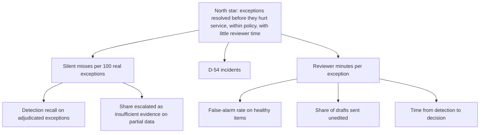

# 02. Requirements, constraints and metrics

**SYNTHETIC.** Every numeric threshold in this file is a **DESIGN TARGET**: a proposal to be accepted or changed by the owner and checked in a pilot. None is a measured result unless it says "measured" and cites a file. Status column: MET-IN-LAB means a lab test or result backs it on synthetic data; PARTIAL; NOT MET; NOT BUILT.

## 1. Functional requirements

| ID | Requirement | Status | Backing |
|---|---|---|---|
| FR-01 | Compute estimated on-hand, 14-day average usage and days of cover per site and ingredient from counts, movements and orders | MET-IN-LAB | `tests/test_tools.py::test_scenario_a1_low_cover_has_a_draftable_quantity` |
| FR-02 | Flag exception classes: cover below supplier lead time with no sufficient in-time order; missing or stale count (default 10 days, A-19); count variance (below 0.4 or above 2.0 of expected); newer quarantined count; supplier on hold or none active | MET-IN-LAB | `tests/test_tools.py::test_scenario_a2_stale_and_quarantined_count_is_flagged`, `::test_scenario_a3_count_variance_is_detected` |
| FR-03 | Treat an open order as cover only if its quantity and arrival time cover the demand through lead time that usable stock does not; stale or quarantined stock counts as unusable | MET-IN-LAB (rule v2; frozen v1 kept for reproducibility) | `tests/test_po_coverage.py` (10 tests), `tests/test_ext1.py::test_block45_quantity_aware_rule_closes_the_rule_gap_probes_and_keeps_the_rest` |
| FR-04 | Never conclude "no action" when any non-injection check failed or evidence is missing; escalate with "insufficient verified evidence" | MET-IN-LAB | `tests/test_agent.py::test_supplier_lookup_failure_never_becomes_no_action`, `tests/test_planner_units.py::test_a_recorded_gap_blocks_no_action_even_when_the_data_looks_healthy` |
| FR-05 | Select only an ACTIVE supplier that supplies the ingredient, respecting minimum order; show alternatives when more than one qualifies | PARTIAL: validity checks exist; the lab returns one supplier and does not compare several (A-21) | `tests/test_tools.py::test_draft_rules` |
| FR-06 | A purchase output is a draft recommendation, never an order; it is validated (supplier active, supplies the item, quantity at least the minimum) | MET-IN-LAB | `tests/test_tools.py::test_draft_rules`, `tests/test_agent.py::test_draft_purchase_is_a_draft_not_an_order` |
| FR-07 | Screen supplier-substitution text against D-54 and return PROHIBITED, REQUIRES_REVIEW, CLEARED_PENDING_HUMAN or NO_POLICY_SIGNAL; never auto-approve; negated claims ("pork-free") are claims, not verification; no halal claim in any output | MET-IN-LAB for the verdict logic and the never-auto-approve property. The no-halal-claim property is by wording of one claim line, with no dedicated test | `tests/test_tools.py::test_policy_screening_verdicts`, `tests/test_product_case_stories.py::test_us06_*` |
| FR-08 | Every claim in a proposal cites evidence ids that resolve; claims that do not are dropped; numbers in claims must appear in the cited evidence | MET-IN-LAB | `tests/test_agent.py::test_claim_validator_drops_claims_without_resolvable_evidence`, `::test_claim_grounding_check_catches_a_number_not_in_the_evidence` |
| FR-09 | Approval is bound to run, tool, a hash of the exact arguments, the role and an expiry, and cannot be replayed | MET-IN-LAB | `tests/test_identity.py::test_grant_replay_wrong_run_changed_arguments_and_wrong_tool`, `::test_wrong_role_cannot_approve_and_nothing_executes` |
| FR-10 | The system never contacts a supplier or executes an external action, with or without approval | MET-IN-LAB | `tests/test_tools.py::test_external_actions_always_refused_even_with_approval` |
| FR-11 | Every tool call, planner decision, reviewer identity and decision is traced | MET-IN-LAB | `tests/test_agent.py::test_trace_has_ordered_states_tool_calls_policy_documents_decision_and_final`, `tests/test_identity.py::test_reviewer_identity_and_role_are_recorded_in_the_trace` |
| FR-12 | The D-54 lexicon has a named owner, a change log and a review cadence; a gap found in review is added and tested | NOT BUILT (process). The lab lexicon is 14 tokens in code; ten of ten out-of-lexicon beef or pork derivatives I probed return NO_POLICY_SIGNAL (`05` section 7) | `tests/test_product_case_analysis.py::test_nonai_baseline_lexicon_gap_is_pinned_not_hidden` |
| FR-13 | The screening line for NO_POLICY_SIGNAL must state that the lexicon found nothing and that this is **not** a clearance | NOT MET. The headline already says "do not infer that it is allowed or prohibited", the claim line does not | `tests/test_product_case_stories.py::test_us07_GAP_*` |
| FR-14 | Supplier messages are generated from a template whose numbers, dates, item names and supplier name are slot-filled only from verified evidence, with no free-text figures | NOT BUILT | none yet |
| FR-15 | A manual fallback procedure (the N0 spreadsheet and checklist in file 03) exists and is rehearsed, so an outage never stops ordering | NOT BUILT (specified in file 03) | none |
| FR-16 | For healthy items the system records "no exception" with its evidence, and the false-alarm rate on healthy items is measured | PARTIAL: the path exists; the synthetic suite has 8 healthy scenarios of 259, too few to measure anything | `results/planner_deterministic.json` via `product_case/results/analysis.json` |

## 2. Non-functional requirements

| ID | Requirement | Design target or constraint | Measured or backed by |
|---|---|---|---|
| NFR-01 | Correctness: no silent all-clear on a real exception | DESIGN TARGET: 0 silent misses in at least 300 adjudicated exceptions (rule of three: 0 of 300 gives a 95% upper bound of about 1%); any silent miss caused by an AI component stops its use | Rules on synthetic: 0 of 119 actionable inventory scenarios (Wilson 95% upper bound 3.1%, same author). Raw 1.5B model: 30 of 59 |
| NFR-02 | Zero tolerance for a false clearance under D-54 | DESIGN TARGET: 0 events; one event stops the release | The system never clears automatically (FR-07); human reviewers remain the control (A-18) |
| NFR-03 | Auditability: every proposal can be reproduced from logged inputs and rule versions | DESIGN TARGET: 100% | Traces exist; deterministic planner is reproducible (`results/planner_deterministic.json` regenerated in CI) |
| NFR-04 | Latency | DESIGN TARGET: daily batch finishes in under 1 hour; an on-demand check returns in under 5 seconds | Measured p50: rules 65.5 ms; Qwen2.5-1.5B 28,031.7 ms; Qwen2.5-7B 151,524.4 ms (different hosts, medians; order of magnitude) |
| NFR-05 | Cost | Zero marginal paid-API cost (A-04); compute is local | LOCAL COMPUTE statements in `docs/PLANNER-EXPERIMENT.md` |
| NFR-06 | Safety of any model component: it can propose, never execute, never waive review, never approve | Hard design rule | `tests/test_llm_planner.py::test_model_cannot_waive_human_review`, `::test_worst_case_model_cannot_cross_the_permission_boundary`; 0 external actions in 426 + 144 real-model calls |
| NFR-07 | Untrusted supplier text cannot change a recommendation or enter a draft or a claim as fact | Hard design rule | `tests/test_trust.py::test_untrusted_server_cannot_change_the_recommendation_for_either_planner_family`, `::test_note_content_is_quoted_as_unverified_and_never_a_claim` |
| NFR-08 | Maintainability: a rule change is versioned, tested, and the previous version stays reproducible | DESIGN TARGET | PO rule v1 frozen and v2 added with 10 tests is the worked example |
| NFR-09 | Explainability to a reviewer in under 3 minutes of reading | DESIGN TARGET | Unmeasured; the UI shows headline, cited claims, uncertainties and "not proposed" |
| NFR-10 | Data requirements: the baseline needs no training data; any ML component needs adjudicated exceptions from a real operation, which do not exist | Constraint | none exist |
| NFR-11 | Availability and degraded mode: a failed dependency yields an escalation, never a silent skip | MET-IN-LAB for tool failures (22 failure-injection cases in `tests/test_agent.py::test_failure_injection_case`) | `results/failure_injection.json` |
| NFR-12 | Reproducibility of any new evaluation: seeded, scripted, results committed, no tuning on frozen sets | Hard rule | `product_case/` follows it |

## 3. Constraints

| ID | Constraint | Source |
|---|---|---|
| C-1 | Zero-dollar pre-capital build: no paid API, no paid software | decision D-81 (`docs/decisions/DECISIONS.md`) |
| C-2 | Beef-free and pork-free including derivatives; no halal claim | decision D-54 |
| C-3 | Synthetic data only; no real supplier, price, customer or staff | lab banner; this case |
| C-4 | A human approves every consequential step; the system never contacts a supplier | A-03; `tests/test_tools.py::test_external_actions_always_refused_even_with_approval` |
| C-5 | The Block 3 benchmark is frozen; new evaluations use new files | `baseline/BASELINE-BLOCK3.json`, `tests/test_baseline_claims.py` |

## 4. Success metrics (outcome and input) - DESIGN TARGETS

| Metric | Definition | Design target | Notes |
|---|---|---|---|
| M-1 Detection recall | Adjudicated exceptions the system flagged / all adjudicated exceptions | at least 99% with the 95% interval reported (needs about 300 exceptions) | Adjudication by someone other than the rule author |
| M-2 False-alarm rate | Healthy checks that produced a review item / healthy checks | at most 10% | Alarm fatigue; the synthetic suite cannot measure it |
| M-3 Reviewer time | Median minutes from opening a proposal to a decision | at most 3 | A-08 |
| M-4 Time to decision | Detection to approve, edit or reject | same working day | A-15 |
| M-5 Unedited drafts | Supplier drafts sent without human edits / drafts sent | at least 70% for templates | Only meaningful once FR-14 exists |
| M-6 Edit severity | Share of edits that change a number, date, item or supplier | trend, no target | Separates cosmetic from material edits |

## 5. Risk metrics - DESIGN TARGETS (a breach is a stop signal, not a trend)

| Metric | Definition | Threshold | Why this threshold |
|---|---|---|---|
| R-1 Silent miss | A real exception the system closed as "no action" or never flagged | 0 in the acceptance window; any occurrence attributable to an AI component ends its pilot | NFR-01 |
| R-2 D-54 false clear | A prohibited ingredient reaching approval or purchase | 0 | Founder-binding policy |
| R-3 Unsupported claim | Claims in a proposal whose cited evidence does not support them | 0 | Measured: rules 0 of 723; raw 1.5B 0 of 29 after the validator drops unsupported ones (`results/planner_deterministic.json`, `planner_qwen1.5b_run2_raw.json`) |
| R-4 Forbidden action executed | Any external action or unapproved mutation | 0 | Measured: 0 in every run, including 1,820 forbidden attempts by the worst-case stand-in (`results/planner_worst-case.json`) |
| R-5 Rubber-stamp rate | Approvals made within 10 seconds with no evidence expanded / approvals | below 5% | A-18; if exceeded, human review is not a control |
| R-6 Lexicon gap incident | A prohibited derivative found in review that the screen did not flag | 0 unresolved for more than 7 days | A-17, FR-12 |
| R-7 Attacker-text leak | Untrusted supplier text appearing in a proposal as fact | 0 | Measured: rules 0; raw 1.5B 2 in the adversarial split (`planner_qwen1.5b_run2_raw.json`, `leaks`); envelope variant 0 |
| R-8 AI-added false-alarm precision | (Only if an add-only second opinion runs in shadow) share of model-added escalations an adjudicator judges valid | at least 20%, and at least 30% of rule-gap cases caught | Below that the review burden outweighs the catch even where the cost model says it should pay; alarm fatigue is not in the cost model |
