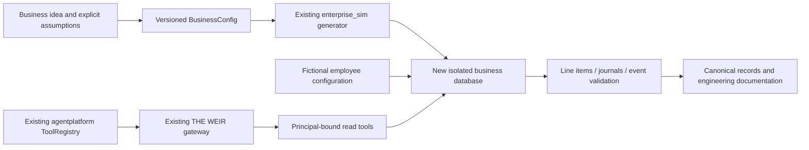

# Enterprise Showcase architecture

This extension adds business domain records and read tools. Existing agentplatform remains responsible for orchestration; THE WEIR remains the gateway for any model-facing tools. Existing governed and Growth modules remain authoritative for procurement/CRM approvals. No new write workflow bypasses them.

## Business creation engine

The reusable spine is `BusinessConfig -> build -> validate -> export`, with a business-scoped Service. CLI accepts tenant, industry and order volume; Python configuration also accepts name, idea, date window and seed. `build(..., workforce=...)` supports a configurable fictional organization. NASHA uses current hospitality source records; Meridian demonstrates a distinct membership catalog and separate store. Other industries need explicit profiles, contracts and tests; the implementation refuses unsupported industries.

The eventual twelve-step user workflow maps as follows:

| Step | Foundation / future UI |
|---|---|
| Idea, blueprint, model | Config and assumptions stored with the business; guided discovery and editable blueprint UI remain planned |
| Organization and agents | Persisted departments/personas, salaries, permissions and queued review tasks; no claim of autonomous execution |
| Technical architecture | This document and source-linked engineering evidence |
| Synthetic data and activity | Existing simulator plus new event/journal records; build is offline and reproducible |
| Analyze and explore | Reconciled summary and scoped source-record views; immersive UI remains planned |
| Inspect decisions | Queued task records and actual WEIR decisions; no invented completed persona decisions |
| Export | Canonical JSON includes domain records, source evidence and reconciled finances |

## Department surfaces

| Planned surface | Bound records or workflow |
|---|---|
| Headquarters | businesses, summary; synthetic disclosure before metrics |
| Executive Floor | project/task status and reconciled performance; decisions must cite events |
| Engineering Studio | engineering_evidence and existing platform run traces/evaluations |
| Data Engineering Center | source generator, contracts, journal reconciliation, PG schema and tests |
| Finance Office | transactions, line items, financial_records, finance_summary |
| Operations Center | operating expense events; existing warehouse/procurement stays the path for inventory and approval workflows |
| Product Studio | projects/tasks, versioned business config; roadmap UI later |
| CRM and Stakeholders | fictional stakeholder cohort and supplier/capital assumptions; connect existing Growth CRM later without real contacts |
| People Operations | configurable agents, permissions, prorated salary events |
| Engineering Playbook | inspected file hashes plus evidence-linked documentation; not fictional business achievements |

List views are intentionally limited to the first 100 ordered rows and expose that limit. They are not complete analytics. Financial totals query the entire journal. Full data is available in the trusted offline export.

## Isolation and security boundaries

SQLite uses one new file per business, unique resolved registry paths, composite tenant keys, read-only connections and an explicit tenant-binding check before reads. Grants bind trusted user + business + fictional agent. Call arguments cannot select identity, SQL, paths, schema, DSN or another tenant. The supplied TenantPrincipal is an in-process trusted host object, not an authentication token. A malicious host or privileged local filesystem user can access all local fixtures; no OS isolation claim is made.

PostgreSQL migration refuses existing schemas and arbitrary identifiers. It adds forced row-level security and a security-invoker aggregate view. RLS uses a host-set tenant setting; the application must own that connection context and never expose arbitrary SQL or user-selected tenant settings. A direct database user who can set session context is outside this application boundary. Before deployment, reuse existing governed identity authorities, scoped non-owner roles and per-tenant grants; do not treat RLS alone as authenticated identity.

No consequential or external tool exists in this adapter. Future writes must reuse existing exact-argument approvals, signed identities, audit chains and default-deny policy; they must not be bolted onto `Service.read`. THE WEIR session/upstream and Tool instance must be newly bound per authenticated principal/tenant, never reused across tenants. The local in-memory read decision list is diagnostic only; the exercised real WEIR Store persists its own gateway audit chain.

## Data and money contract

Schema version 1 is additive and created only into new stores. Every business is marked synthetic; agent/stakeholder identities are fictional. Events reference source order IDs or explicit assumption identifiers, carry actor and payload, and form a deterministic hash chain in ingestion order (not necessarily occurrence-date order). Transactions point to one event; journal entries point to transactions. Composite foreign keys prevent cross-business links.

Sale line sums equal source subtotals; discounts explain sale totals. Refunds retain source order/line references. Debits equal credits and expected account mappings for every transaction. Cash equals opening capital plus modeled net income. Revenue is net of source merchandise refunds, excludes tax/tips, and is not a real business result. 35% expenses are a simplifying cost proxy. Fictional salaries are prorated annual salary/12 by active calendar days, using integer arithmetic. They are not actual agent operating costs. Opening capital supports a negative-income scenario without hiding it.

Canonical exports are stable for the same source revision, scenario and dependency versions. The existing simulator guarantees determinism on the same NumPy major version; cross-version RNG/output stability is not promised. No source fixture, historical metric or menu definition is rewritten.
