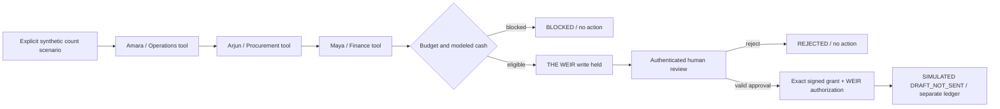

# Phase 4 — governed workforce engineering playbook

**Implemented:** deterministic inventory-to-procurement demonstration, not live LLM inference. Existing Phase 3 views and both financial fixtures are preserved. This extension uses the existing production platform ToolExecutor/ToolRegistry/typed ToolResult/Tracer, THE WEIR Gateway/Store, local signed Authority grants, governed Ledger and trace Store. It introduces domain adapters, not a second agent framework.

## Workflow and state

The existing ledger persists STARTED → EVIDENCE_COLLECTED → PROPOSED → AWAITING_APPROVAL → APPROVED → EXECUTED, with ABSTAINED, BLOCKED, REJECTED and FAILED outcomes. Agent states and tool calls are shown only when their records exist. Three personas participate; the remaining configured profiles do not execute.

## Data contracts

Operations receives an explicitly injected expected/count/target snapshot; a missing count fails closed. Procurement receives a validated replenishment quantity and hypothetical unit cost. Finance receives the proposed amount, hypothetical budget, and actual available modeled cash from the selected immutable foundation fixture. Pydantic input/output models constrain structured results; exact role/tool/run/input bindings prevent arbitrary tool execution.

These fixtures contain no authoritative inventory measurement or supplier quote for this workflow. Inventory discrepancy, stock target, unit cost and budget are planning assumptions, clearly separated from real source-derived synthetic cash. No historical journal, inventory balance or supplier record is modified. The only effect is a DRAFT_NOT_SENT record in a separate per-tenant workflow ledger; it is never sent or booked as a purchase.

## Authorization boundary

The existing loopback host authenticates a local review session. The host derives an opaque reviewer identity from that session; users cannot supply tenant, role, signer, effect or arbitrary action arguments. Tenant selection uses the existing authenticated session and grants. Workflows and approvals are restricted to the initiating review session; another tenant/session cannot inspect or decide them.

THE WEIR first holds the exact write call. Human approval must match its workflow, approval ID and canonical action hash, before its TTL expires. The existing Authority issues a signed grant bound to reviewer, run, tool and arguments; a different Authority is used per tenant. The upstream checks both the signed grant and the resolved WEIR approval, requires complete valid audit/agent records, and only then calls the existing transactional/idempotent procurement Ledger. Replayed decisions are refused. The unique proposal and idempotency keys prevent duplicate effects.

The local code establishes one reviewer capability, not production SSO, organizational separation of duties or a real person's verified identity. The proposer is a fictional procurement agent; the local human reviewer can initiate and approve its demonstration. Do not expose this local host publicly. Existing Authority prototypes have process-local signing secrets/nonces; pending flows cannot be resumed by a new authenticated session after host restart. Persistent ledger/WEIR states and unique effects still prevent a duplicate draft. Production identity, durable approval authorities, delegated reviewers and reviewed role policies remain required before deployment.

## Execution, observability and recovery

The real ToolExecutor validates calls, enforces per-call timeouts, and allows at most one retry for a read timeout. All three stage tools run through the real WEIR Gateway with a per-role tool allowlist. The consequential write is mediated directly by THE WEIR's persisted approval mechanism; no alternate approval queue bypasses it. Write retries are not automatic. A timeout after a committed draft is reconciled by the existing proposal/idempotency key; absent effects fail closed and require a new reviewed workflow.

Correlation/workflow IDs, tenant, scenario inputs, source-derived cash, stage inputs/outputs, actual tool attempts, elapsed time, policy decisions, human decisions and final outcomes are retained in existing ledger/trace/WEIR stores. Signed grants and session credentials are not written to trace events. Before execution, chain checks and required agent/approval records must pass. These are application-level integrity controls, not protection against an administrator rewriting the entire filesystem and all anchors.

## Model and evaluation status

No approved showcase model/provider binding is configured. No paid provider was requested and no Claude Code model-live evaluation was assumed to pass or rerun. The implemented execution mode is always DETERMINISTIC_REPLAY. It exercises real orchestration/tool/approval software with scripted business analysis; it must never be described as live AI inference. Use the existing provider/planner interfaces only after the separate upstream reliability work supplies an approved integration.

Run the test and browser commands in README.md. Execution counts and test results belong to actual reports, not this narrative. No per-agent model quality score is invented.
